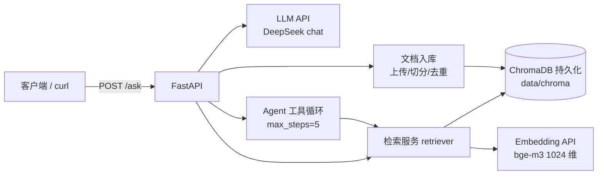

# ai-dev-learning

> 8 周 AI 应用开发学习仓库 + 主项目：**RAG 知识库问答服务**（FastAPI + LangChain + ChromaDB + DeepSeek API + Docker）。
> 目标岗位：AI 应用开发工程师（RAG / LangChain / 大模型 API / FastAPI / Docker）。

[](https://github.com/2961768276/ai-dev-learning/actions/workflows/ci.yml)

<!-- ========== 三条数字：Day 49 前用真实评测结果替换 TODO，不许编 ========== -->
| 指标 | 数值 | 证据 |
|---|---|---|
| 检索 hit@3 | `TODO` | `docs/eval_v1.md` |
| 端到端 P95 延迟 | `TODO` | `docs/perf_v1.md` |
| 单问成本 | `TODO` | `docs/perf_v1.md` |

## 架构



## Quickstart

前置：uv、Python 3.11、一个 DeepSeek API Key（写入 `.env`，格式见 [.env.example](.env.example)）。

**方式 A：本地 uv**

```bash
cp .env.example .env      # 填 DEEPSEEK_API_KEY（可选 SILICONFLOW_API_KEY）
uv sync
./scripts/dev.sh          # http://127.0.0.1:8000/docs
```

**方式 B：docker compose**

```bash
docker compose up -d --build
curl -s http://127.0.0.1:8000/health
```

**验收（两种方式都跑）**

```bash
./scripts/smoke_test.sh   # health → chat → ask → search，任一失败返回非零
```

**代码质量（W1 起就有）**

```bash
./scripts/test.sh         # ruff check + pytest（用假客户端，不联网不花钱）
```

## 接口

| 方法 | 路径 | 说明 | 落地日 |
|---|---|---|---|
| GET | `/health` | 存活与版本 | Day 29 |
| GET | `/version` | 版本信息 | Day 29 |
| POST | `/chat` | 纯对话，带参数与 usage | Day 30 |
| POST | `/ask` | RAG 问答，返回 answer + sources | Day 31 |
| GET | `/search?q=&top_k=` | 只检索不生成 | Day 31 |
| POST | `/documents` | 上传文档入库（含去重） | Day 36 |
| GET | `/documents` | 文档列表 | Day 37 |
| DELETE | `/documents/{doc_id}` | 删除文档与其向量 | Day 37 |
| POST | `/agent/chat` | 工具调用 / Agent 闭环 | Day 43 |

## 8 周进度

- [ ] W1 D1–D7　云端 LLM API 打底（参数 / usage / 多轮 / 结构化输出 / 重试）
- [ ] W2 D8–D14　Prompt 设计 + 评测 + Function Calling
- [ ] W3 D15–D21　**手写** RAG 全链路（加载→切分→向量化→Chroma→检索→生成）
- [ ] W4 D22–D28　LangChain 核心 + LCEL 重构 RAG
- [ ] W5 D29–D35　FastAPI 服务化 + Docker（tag `v0.1.0`）
- [ ] W6 D36–D42　项目迭代 I：上传/管理/多轮/拒答 + 评测（tag `v0.2.0`）
- [ ] W7 D43–D49　项目迭代 II：Agent / MCP / 测试 / CI（tag `v1.0.0`）
- [ ] W8 D50–D56　简历 / 项目故事 / 模拟面试

## 每日记录

格式：`- Day X｜做了什么（一句运行结果）｜产物路径｜今天的卡点`

- Day 1｜打通 DeepSeek 首次调用，打印 content / finish_reason / usage / 耗时并存原始响应｜[lessons/w1/day01_smoke.py](lessons/w1/day01_smoke.py)、[lessons/w1/out/day01_resp.json](lessons/w1/out/day01_resp.json)｜卡点：中文在编辑器里被存成 `?`，改 UTF-8 后解决
- Day 2｜对比 temperature 0 / 0.7 / 1.3 与 max_tokens=20 的影响，temperature=0 跑两次做复现性对照｜[lessons/w1/day02_params.py](lessons/w1/day02_params.py)、[lessons/w1/out/day02_params.md](lessons/w1/out/day02_params.md)｜卡点：`**kw` 参数透传；`max_tokens=20` 时 content 为空，因为 reasoning token 也吃预算
- Day 3｜抽出统一客户端 `chat(messages, **kw)`，每调用一行 usage jsonl，连跑 3 次并打印当日累计｜[src/ai_dev_learning/common/llm.py](src/ai_dev_learning/common/llm.py)、[lessons/w1/day03_usage.py](lessons/w1/day03_usage.py)、`logs/usage.jsonl`｜卡点：配置写死在代码里、日志内容被截断，改成读 `.env` + 只截日志预览

<!-- 从 Day 4 继续往下追加 -->

## 目录

```
src/ai_dev_learning/     # 可复用代码：common / core / services / api / main.py
lessons/w1..w4/          # 每日脚本 + out/ 产物（提交，作为学习证据）
data/corpus/             # 语料（提交）
data/chroma/             # 向量库持久化（gitignore）
data/uploads/            # 上传文件（gitignore）
logs/                    # usage / errors / tool_trace 日志（gitignore）
scripts/                 # dev / test / smoke_test / build / eval / list_models
tests/                   # pytest
docs/                    # 评测报告、架构、agent 失败案例、smoke 记录
career/                  # 简历、项目故事、题库、模拟面试（W8）
```

## 证据索引

| 想证明什么 | 打开 |
|---|---|
| RAG 效果与检索命中率 | `docs/eval_v1.md` |
| 拒答 / 幻觉控制 | `docs/eval_refusal.md` |
| 性能与成本 | `docs/perf_v1.md` |
| 架构与数据流 | `docs/architecture.md` |
| Agent 边界与护栏 | `docs/agent_failure_cases.md` |
| 测试覆盖 | `docs/test_report.md` |
| 手写 RAG vs LCEL | `lessons/w4/out/handrolled_vs_lcel.md` |

> 上面这些文件按日程创建（`docs/smoke/` 从 Day 29 起、`docs/eval_*` 从 Day 39–40、`docs/test_report.md` 在 Day 47）。
> Day 49 收尾时把它们统一改成 Markdown 链接，让 README 可点。

## 环境变量

见 [.env.example](.env.example)。`.env` 永不提交（`.gitignore` 已拦截），镜像里也不打包 `.env`。

**模型名以接口为准**（`deepseek-chat` 已停用，2026-11 实测只剩两个）：

```bash
uv run python scripts/list_models.py   # 打印当前可用模型，写死之前先跑一次
```

| 模型 | 代次 | 用途 |
|---|---|---|
| `deepseek-flash` | 4.1 | 日常默认：快、便宜，会返回 `reasoning_content` |
| `deepseek-v4-pro` | v4 | 难任务 / 对照实验，更强更贵 |


## 硬件约束（8GB M1）

- 生成模型**一律走云端 API**，本地不跑 7B 及以上模型。
- 嵌入默认云端 `BAAI/bge-m3`（1024 维）；本地仅用 `nomic-embed-text`（768 维，约 274MB）做对照，两者分属不同 Chroma collection。
- 向量库只用 ChromaDB，持久化在项目内 `data/chroma`。
- 不装任何需要 GPU 的依赖；不同时开 Docker Desktop 与本地 Ollama。

## 学习计划

完整 56 天日程、每日复盘三问与教练指令模板见仓库根目录的 [ai-dev-learning-8week-plan.md](ai-dev-learning-8week-plan.md)。

